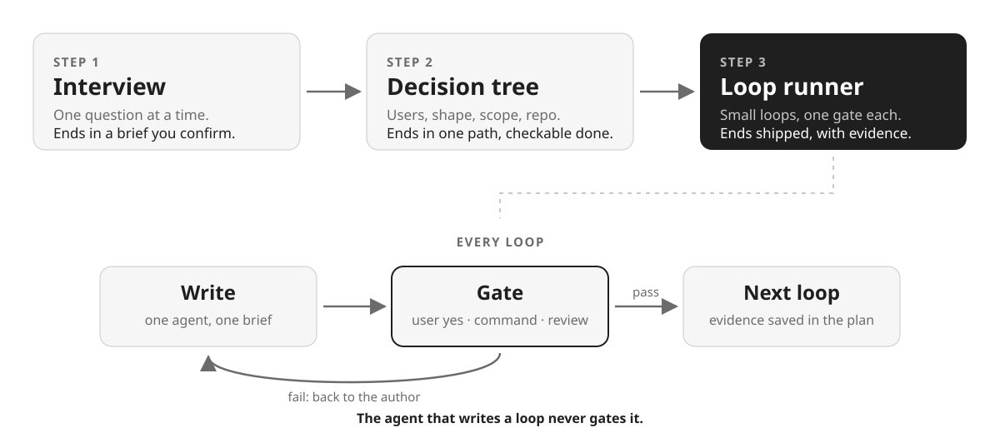

<p align="center">
  <picture>
    <source media="(prefers-color-scheme: dark)" srcset="assets/banner-dark.svg">
    
  </picture>
</p>

<p align="center">
  <a href="https://github.com/shachafnave/looper/actions/workflows/plugin-ci.yml"></a>
  <a href="LICENSE"></a>
  
</p>

<p align="center">
  <b>Stop vibe-building. Start looping.</b><br>
  looper turns "build me something" into a short interview, one clear decision, and a run of small agent loops.
  Every loop has a gate, and the agent that wrote the work is never the one that signs it off.
</p>

---

## Install

In Claude Code:

```
/plugin marketplace add shachafnave/looper
/plugin install agent-loop-runner@agent-loop-runner
```

Or from your terminal:

```bash
claude plugin marketplace add shachafnave/looper
claude plugin install agent-loop-runner@agent-loop-runner
```

Then just say what you want to build. The skills trigger on their own.

## What it does

<p align="center">
  <picture>
    <source media="(prefers-color-scheme: dark)" srcset="assets/how-it-works-dark.svg">
    
  </picture>
</p>

Most AI coding goes wrong before the first line of code: the goal was fuzzy, the
shape was never decided, and the same agent that wrote the code also said it was
fine. looper fixes those three things in order.

| Step | Skill | What you get |
| --- | --- | --- |
| 1 | `interview` | One question per message, never more than you need. Ends in a four-part brief (goal, users, constraints, done) that you confirm before anything is written. |
| 2 | `decision-tree` | Walks four fixed branches: who uses it, what shape it takes (web app, CLI, Claude plugin, MCP server, library), one tool or several, and where it lives. Each branch shows the choice, why, and what would flip it. Ends in one path with done criteria a command or a yes can check. |
| 3 | `loop-runner` | Splits the build into small loops. Each loop names its agent, its output and its gate, is saved to a plan file, and runs on its own branch. Evidence for every gate is written down. |

And one agent:

| Agent | Job |
| --- | --- |
| `loop-reviewer` | A fresh-context reviewer that tries to break one loop's output. Every objection quotes the exact line and shows a concrete failure. If it cannot break it, it says `No objections found.` and lists what it tried. |

## The gates

Every loop ends at one of three gates:

- **user yes**: your exact words, recorded in the plan.
- **command**: build, lint, test or CI; the command and its output are recorded.
- **review**: a reviewer that did not write the loop tries to break it.

A failed gate goes back to the author. Three failures on the same gate and looper
stops and asks you. Nothing outward-facing (push, publish, a public repo) happens
without asking first.

## Fit it to your project

looper works with no setup. To plug in your own reviewer, skills, commands and
folders, add `.claude/loop-runner.json` to your project. Every key is optional:

```json
{
  "reviewer_agent": "my-reviewer",
  "review_skill": "my-review",
  "ui_gate_skill": "my-mockup-flow",
  "error_skill": "my-error-log",
  "commands_from": "AGENTS.md#Commands",
  "ship_skill": "my-deploy",
  "plan_dir": "docs/plans",
  "spec_dir": "docs/specs",
  "on_new_file": "Add a row for the file to docs/file-index.md.",
  "rules_file": "AGENTS.md"
}
```

| Key | What it sets | Default |
| --- | --- | --- |
| `reviewer_agent` | Agent for every `review` gate | the bundled `loop-reviewer` |
| `review_skill` | Skill that wraps the reviewer | dispatch the agent directly |
| `ui_gate_skill` | Runs before any loop that changes a UI | a plain user-yes gate |
| `error_skill` | Called on any unexpected failure | noted in the plan |
| `commands_from` | File (and `#Section`) to read build, lint, test from | asked once |
| `ship_skill` | The final ship loop | stop at an open PR |
| `plan_dir`, `spec_dir` | Where plans and specs go | `docs/loops/` |
| `on_new_file` | Instruction for every file a loop creates | none |
| `rules_file` | Read first by every loop agent; your corrections are added to it | none |

A bad config never half-runs. An unknown key, a missing agent or skill, a path
outside the project, or malformed JSON stops looper before it makes a branch, and
it names every problem. The file is also described by
[`schema/loop-runner.schema.json`](schema/loop-runner.schema.json) for editor
autocomplete.

## Tested like code

Each skill was written test-first: a baseline agent ran the example cases without
the skill, its failures were written down, and the skill was written to fix them.
The suite lives in [`evals/`](evals) and runs with `claude plugin eval`:

```bash
scripts/check-plugin.sh
claude plugin eval . --trust-plugin --scaffold --allow-tools Bash Write Edit
```

CI runs the static checks on every pull request, and the model evals whenever an
`ANTHROPIC_API_KEY` secret is set.

## Repository layout

```
.claude-plugin/    plugin and marketplace manifests, icon
skills/            interview, decision-tree, loop-runner
agents/            loop-reviewer
schema/            JSON schema for .claude/loop-runner.json
evals/             claude plugin eval cases and fixtures
scripts/           static checks used by CI
assets/            logo, banners and diagrams (SVG)
```

## License

[MIT](LICENSE)

---

<p align="center">
  <picture>
    <source media="(prefers-color-scheme: dark)" srcset="assets/author-dark.svg">
    
  </picture>
  <br>
  <a href="https://www.linkedin.com/in/shachaf-nave">linkedin.com/in/shachaf-nave</a>
</p>
